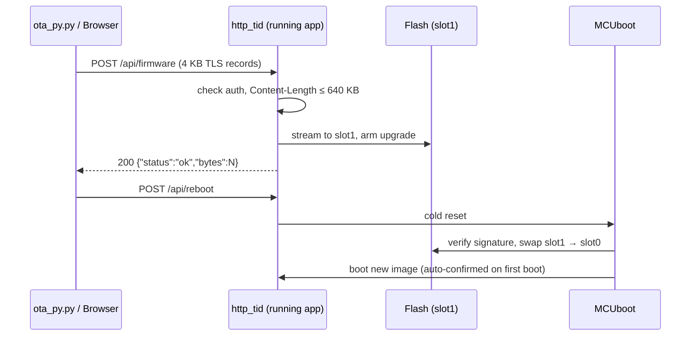

# Build, Flash & OTA

How to build the firmware, put it on the board over the network (OTA) or over USB (SWD), and
what to do when something goes wrong. Board: NUCLEO-H753ZI at `192.168.1.80`.

---

## Quick reference

```bash
# build web UI + firmware, then OTA-flash over HTTPS
bash scripts/ota_flash.sh

# build only (no upload)
bash scripts/ota_flash.sh --build

# upload an existing image
python3 scripts/ota_py.py ~/zephyr-3.7/build/zephyr/zephyr/zephyr.signed.bin
```

`ota_flash.sh` runs three steps: **build the web UI** (`webui/`, `npm run build`), **build the
firmware** (`west build --sysbuild`), then **upload** the signed image with `ota_py.py`.

---

## What you need

| Item | Where | Notes |
|------|-------|-------|
| Zephyr **v3.7.0** workspace | `~/zephyr-3.7` | See [below](#zephyr-workspace). The repo does not build on newer Zephyr. |
| Python venv with `west` | `~/zephyr-3.7-venv` | Zephyr requirements installed. |
| ARM toolchain | `~/zephyr-sdk-1.0.1/gnu/arm-zephyr-eabi` | Used through the `cross-compile` variant. |
| Node 18+ and npm | system | For the web UI build. |
| API token | `zephyr/src/http/http_auth.hpp` | Git-ignored, 64 hex characters. Or set `HDV_TOKEN`. |
| TLS certificate and key | `zephyr/certs/server.crt`, `server.key` | Git-ignored. |
| MQTT broker CA | `zephyr/certs/broker_ca.crt` | Git-ignored. Must match the broker. |
| Signing key | `bootloader/mcuboot/root-rsa-2048.pem` in the workspace | See [Signing](#signing-key). |

!!! danger "Credentials are not in the repository"
    The token, certificate, key and broker CA are git-ignored. **They are compiled into the
    firmware.** A fresh clone has none of them, and generating new ones does not match the
    firmware already on a board: copy the originals from the machine that built the running
    image, or reflash over USB with the new set. Never commit them. Rotation:
    `bash scripts/gen_http_token.sh`, then rebuild and flash.

---

## Zephyr workspace

`zephyr/west.yml` pins Zephyr **v3.7.0**. The sysbuild MCUboot overlay
(`zephyr/sysbuild/mcuboot.overlay`) refers to the `scratch_partition` node of that release; on a
newer Zephyr (for example 4.x) the MCUboot configure step fails with
`undefined node label 'scratch_partition'`.

```bash
python3 -m venv ~/zephyr-3.7-venv
~/zephyr-3.7-venv/bin/pip install west
mkdir ~/zephyr-3.7 && cd ~/zephyr-3.7
~/zephyr-3.7-venv/bin/west init -m https://github.com/zephyrproject-rtos/zephyr --mr v3.7.0
~/zephyr-3.7-venv/bin/west update --narrow --fetch-opt=--depth=1
~/zephyr-3.7-venv/bin/pip install -r zephyr/scripts/requirements.txt
```

### Toolchain

Zephyr 3.7.0 only accepts Zephyr SDK 0.16.x. To reuse a newer SDK, point Zephyr at its ARM
compiler with the `cross-compile` variant (this is what `ota_flash.sh` does):

```bash
export ZEPHYR_BASE=~/zephyr-3.7/zephyr
export ZEPHYR_TOOLCHAIN_VARIANT=cross-compile
export CROSS_COMPILE=~/zephyr-sdk-1.0.1/gnu/arm-zephyr-eabi/bin/arm-zephyr-eabi-
unset ZEPHYR_SDK_INSTALL_DIR
```

### Manual build

```bash
source ~/zephyr-3.7-venv/bin/activate
(cd webui && npm ci && npm run build)
cd ~/zephyr-3.7
west build -b nucleo_h753zi -d ~/zephyr-3.7/build \
    ~/repos/vehicle-Dynamics-Sim-Can/zephyr --sysbuild
```

Outputs, under `~/zephyr-3.7/build/`:

| File | Use |
|------|-----|
| `zephyr/zephyr/zephyr.signed.bin` | OTA upload |
| `zephyr/zephyr/zephyr.signed.hex` | SWD flash, app at `0x08040000` |
| `mcuboot/zephyr/zephyr.hex` | SWD flash, bootloader at `0x08000000` |

Use a **separate build directory** for this project. `west build` on a directory that holds
unrelated build output can delete it.

---

## Signing key

`zephyr/CMakeLists.txt` sets `MCUBOOT_SIGNING_KEY_FILE` to `zephyr/mcuboot_signing_key.pem`, but
**sysbuild ignores it**. Sysbuild signs the app, and builds the matching MCUboot, with
`SB_CONFIG_BOOT_SIGNATURE_KEY_FILE`, which defaults to MCUboot's public test key
`bootloader/mcuboot/root-rsa-2048.pem` (RSA-2048). This is explained in
[MCUboot signing & flash recovery](../mcuboot_signing_and_flash_recovery.md).

Check an image before you upload it:

```bash
~/zephyr-3.7-venv/bin/python ~/zephyr-3.7/bootloader/mcuboot/scripts/imgtool.py verify \
    -k ~/zephyr-3.7/bootloader/mcuboot/root-rsa-2048.pem \
    ~/zephyr-3.7/build/zephyr/zephyr/zephyr.signed.bin
# → Image was correctly validated
```

!!! warning "Development key"
    The test key is public: anyone can sign an image this board will accept. Replace it with a
    project key before the board is exposed (see [Security hardening](SECURITY_HARDENING.md)).
    The key is embedded in MCUboot, so changing it needs an SWD flash of the bootloader.

!!! note "Docs that say ECDSA-P256"
    [MCUboot OTA](MCUBOOT_OTA.md) and [Security hardening](SECURITY_HARDENING.md) describe an
    ECDSA-P256 chain, which is what `sysbuild/mcuboot.conf` asks for. The built, verified images
    use RSA-2048. Treat the signing recovery page as authoritative until those pages are
    reworked.

---

## OTA update



- `scripts/ota_py.py` sends the body in 4096-byte writes, so each is one TLS record. The browser
  upload on the OTA page (`/ota`) works the same way.
- After the upload the board reboots into MCUboot, which swaps and boots the new image. Expect
  the board to be unreachable for roughly 10 to 30 s. The OTA page waits for it and returns to the
  dashboard.
- `main.cpp` confirms the image on first boot. An image that fails to boot is not confirmed, and
  MCUboot reverts to the previous one.
- Slot layout: slot0 and slot1 are **640 KB** each (`app.overlay`, `sysbuild/mcuboot.overlay`).
- OTA only replaces the application. MCUboot itself lives in `boot_partition` and cannot be
  updated this way.

!!! warning "The OTA page is part of the firmware"
    A broken UI build can make the OTA page unusable. `ota_py.py` talks to the API directly and
    keeps working, so always keep it as the fallback.

---

## Flashing over USB (SWD)

Use this for a blank board, a changed bootloader or key, or when OTA is not available (no
Ethernet, or the board is unreachable). It overwrites the bootloader and the application.

```bash
cd ~/zephyr-3.7/build
PYOCD=~/zephyrproject/.venv/bin/pyocd
pyocd list      # find the probe of the H753 board

OPTS="-u <probe-id> --target stm32h743xx -O connect_mode=under-reset"
$PYOCD flash $OPTS mcuboot/zephyr/zephyr.hex
$PYOCD flash $OPTS zephyr/zephyr/zephyr.signed.hex
$PYOCD reset $OPTS
```

- **`--target stm32h743xx` with `connect_mode=under-reset`** is the combination that attaches.
  The chip-specific `stm32h753zitx` target failed to attach on this board with
  `STLink error (5): No device connected`.
- With **two Nucleo boards** connected, pass `-u <probe-id>` so only the H753 is touched.
- Flash both images from the **same build**; sysbuild keeps the key in MCUboot and the signature
  on the app paired.
- The storage partition at `0x08020000` is not written.

### Serial console

The ST-LINK exposes a virtual COM port (`/dev/ttyACM*`, 115200 baud). Match it to the board by
`/dev/serial/by-id`.

```bash
picocom -b 115200 /dev/ttyACM1      # exit: Ctrl+A Ctrl+X
```

Useful shell commands: `kernel uptime`, `kernel version`, `network mac` (MAC, IP and port),
`threads`, `stats`, `mem`, `mqtt …`, `plant …`, `can …`. The firmware does not log continuously;
press Enter to get a prompt.

---

## Troubleshooting

| Symptom | Cause / fix |
|---------|-------------|
| `undefined node label 'scratch_partition'` | Building against Zephyr 4.x. Use the v3.7.0 workspace. |
| `Could not find … Zephyr-sdk … version "0.16"` | Zephyr 3.7 rejects SDK 1.0. Use the `cross-compile` variant above. |
| `webui/dist/index.html missing` | Run `npm ci && npm run build` in `webui/`. |
| OTA returns 401 | Token does not match the one compiled into the running firmware. |
| `No route to host`, ARP `FAILED` for 192.168.1.80 | Board has no Ethernet link. USB only powers it and carries the console. Connect the RJ45 port to the same network. Check with `network mac` on the console. |
| MQTT `connect … failed (-116)` in the console | Timeout reaching the broker; expected without a network link. |
| `STLink error (5): No device connected` | Use `--target stm32h743xx -O connect_mode=under-reset`. |
| HTTP source selected, but commands do nothing | The source selector must send `ctrl=http` (names), and commands must be refreshed within 500 ms. See [Web UI](WEB_UI.md#http-api). |
| Board unreachable after an update | Wait 30 s for the MCUboot swap. If it persists, read the console. A bad image is reverted automatically; otherwise reflash over SWD. |
