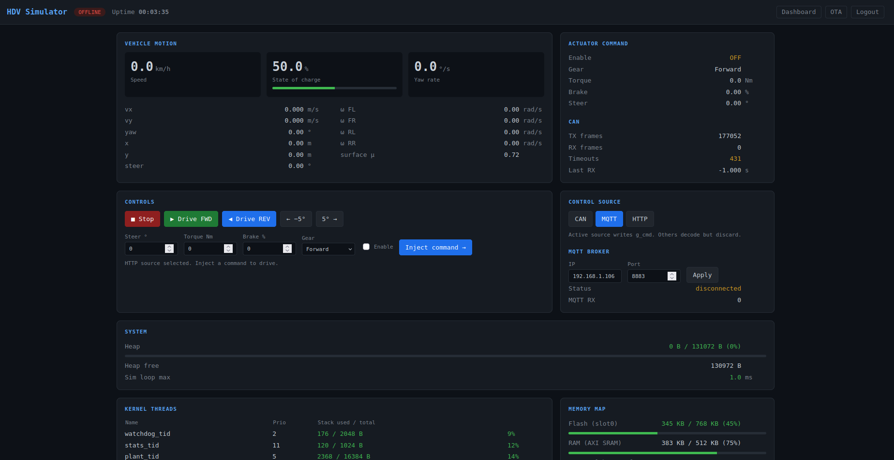
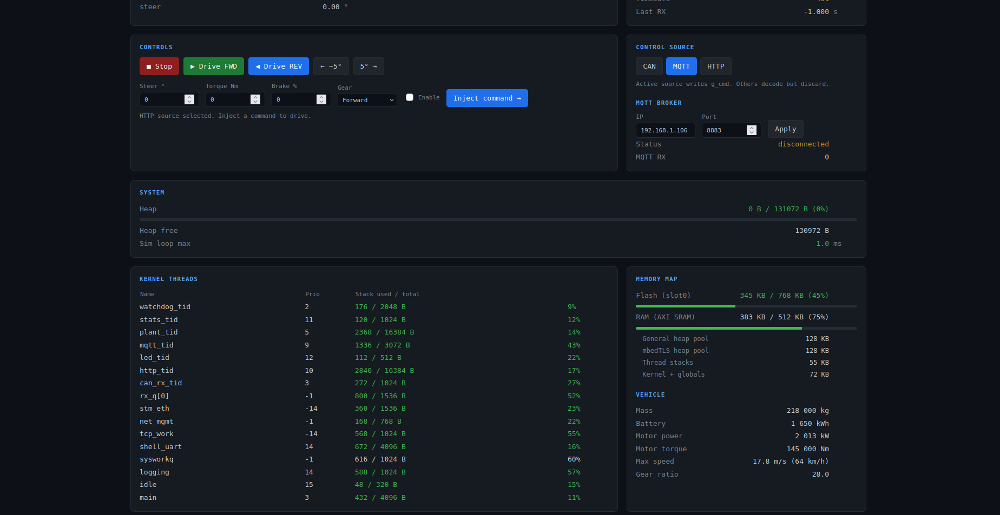
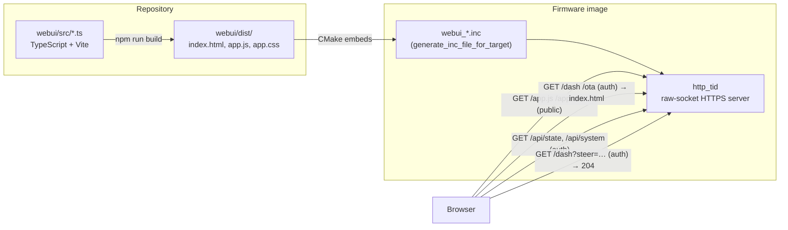

# Web UI & HTTP API

The board serves its own dashboard over HTTPS (`https://192.168.1.80`). The UI is a small
TypeScript single-page app built with Vite, embedded in the firmware image at build time. No
file system, no external server, and no framework: the whole bundle is about 17 KB.





---

## What the dashboard shows

| Card | Content | Source |
|------|---------|--------|
| Vehicle motion | Speed, state of charge, yaw rate, vx / vy / yaw / x / y / steer, wheel speeds, surface μ | `/api/state` |
| Actuator command | Enable, gear, torque, brake, steer as seen by the plant | `/api/state` |
| CAN | TX / RX frames, timeouts, time of last RX | `/api/state` |
| Controls | Stop, Drive FWD / REV, steer ±5°, manual inject form | `/dash?…` |
| Control source | CAN / MQTT / HTTP selector, MQTT broker address and port | `/dash?…` |
| System | Heap use, free heap, worst-case simulation loop time | `/api/state` |
| Kernel threads | Priority and stack use per thread | `/api/system` |
| Memory map | Flash (slot0) and RAM image footprint, heap pools, stacks | `/api/system` |
| Vehicle | Mass, battery, motor power / torque, max speed, gear ratio | static |

There is also an **OTA** view (`/ota`) for uploading firmware. See
[Build, Flash & OTA](BUILD_AND_OTA.md).

---

## Architecture



- `index.html` is the same shell for `/dash` and `/ota`. `main.ts` reads `location.pathname`
  and mounts the dashboard or the OTA view.
- The login page is separate, a small server-rendered HTML form (`http_page.cpp`). It sets the
  session cookie, then redirects to `/dash`.
- The UI polls `/api/state` every 2 s and `/api/system` every 5 s.
- A request that returns **401** sends the browser back to the login page.

### Source layout

```
webui/
├── index.html            shell, loads /app.js and /app.css
├── mock-api.ts           Vite dev plugin: fake board for local development
├── vite.config.ts
└── src/
    ├── main.ts           routes /ota vs everything else
    ├── dashboard.ts      dashboard view, controls, command hold
    ├── ota.ts            OTA upload view
    ├── api.ts            fetch helpers (getState, getSystem, sendCmd)
    ├── types.ts          State / System interfaces = the JSON the firmware sends
    └── style.css
zephyr/src/http/
├── http_server.cpp       accept loop, routing
├── http_cmd.cpp          request parsing, apply_web_cmd()
├── http_page.cpp         login page, /api/state, /api/system, embedded assets
├── http_ota.cpp          /api/firmware, /api/reboot
├── http_session.cpp      session cookies
└── http_internal.hpp
```

---

## HTTP API

All endpoints except the login page and the static assets require authentication: either a
valid session cookie (`sid=…`, set by `POST /login`) or `Authorization: Bearer <token>`.

| Method | Path | Auth | Response |
|--------|------|------|----------|
| GET | `/`, `/login` | no | Login page |
| POST | `/login` | no | `token=<hex>` body; sets session cookie, redirects to `/dash` |
| GET | `/logout` | no | Invalidates the session, redirects to `/` |
| GET | `/app.js`, `/app.css` | no | Embedded UI assets (contain no secrets) |
| GET | `/dash` | yes | UI shell (`index.html`) |
| GET | `/dash?<params>` | yes | Applies the command, returns **204** |
| GET | `/ota` | yes | UI shell, OTA view |
| GET | `/api/state` | yes | Plant, command, CAN and MQTT telemetry (JSON) |
| GET | `/api/system` | yes | Threads, memory map, MQTT broker settings (JSON) |
| POST | `/api/firmware` | yes | Raw `zephyr.signed.bin` body, streamed to slot1 |
| POST | `/api/reboot` | yes | Cold reboot into MCUboot to apply the update |

### Command parameters (`GET /dash?…`)

| Parameter | Values | Effect |
|-----------|--------|--------|
| `steer` | −45 … 45 (°) | Steering command |
| `torque` | 0 … 145000 (Nm) | Drive torque |
| `brake` | 0 … 100 (%) | Brake command |
| `gear` | `F`, `R`, `N` | Gear selector |
| `enable` | `0`, `1` | System enable |
| `ctrl` | `can`, `mqtt`, `http` | Active control source (names, not numbers) |
| `broker_addr`, `broker_port` | string / 1 … 65535 | MQTT broker; triggers a reconnect |

Values are clamped to physical limits in `apply_web_cmd()` before they reach `g_cmd`.

!!! warning "Command source and watchdog"
    Only the **active control source** can write `g_cmd`. Commands sent while the source is not
    `http` are decoded and discarded. In addition, the plant resets any command that has not been
    refreshed for **500 ms** (`CAN_RX_TIMEOUT_S`). The dashboard therefore resends the active
    command every 300 ms while the HTTP source is selected, and releases it on **Stop** or when
    the source changes. Scripts that talk to `/dash?…` directly must do the same.

### `/api/state`

```json
{"uptime":215,"vx":0.000,"vy":0.000,"yaw":0.00,"yawr":0.00,"x":0.00,"y":0.00,
 "steer":0.00,"soc":50.0,"ofl":0.00,"ofr":0.00,"orl":0.00,"orr":0.00,"mu":0.72,
 "en":0,"gear":"F","torq":0.0,"brk":0.00,"csteer":0.00,
 "cantx":177052,"canrx":0,"canto":431,"lrx":-1.000,
 "hu":0,"hf":130972,"htot":131072,"loop":1000,
 "mqc":0,"mqrx":0,"src":0}
```

`src` is the control source (0 = CAN, 1 = MQTT, 2 = HTTP). `loop` is the worst-case plant step in
µs. The TypeScript interface is `State` in `webui/src/types.ts`.

### `/api/system`

```json
{"broker_addr":"192.168.1.106","broker_port":8883,
 "flash_used":353244,"flash_total":655360,"ram_image":391864,"ram_total":524288,
 "heap_gen":131072,"heap_tls":131072,"stacks":55296,
 "threads":[{"n":"plant_tid","p":5,"u":2368,"t":16384}]}
```

`flash_total` is read from the devicetree (`slot0_partition`, 640 KB), so it follows the
partition layout in `app.overlay`. The interface is `System` in `webui/src/types.ts`.

---

## Developing the UI

Node 18 or newer is enough (the project pins Vite 5).

```bash
cd webui
npm ci
npm run dev        # http://localhost:5173, served against a built-in mock board
```

The mock (`mock-api.ts`) implements `/api/state`, `/api/system`, `/api/firmware`, `/api/reboot`
and the command parameters, so the whole UI, including the OTA view, can be exercised without
hardware. To point the dev server at a real board instead:

```bash
HDV_PROXY=https://192.168.1.80 HDV_COOKIE="sid=<session cookie>" npm run dev
```

!!! note "Dev server ≠ production bundle"
    The dev server loads modules lazily; the firmware serves one bundled file. Check the
    production bundle (`npm run build`) on the board before relying on a change.

`npm run build` type-checks (`tsc --noEmit`) and writes `webui/dist/`. CMake refuses to build the
firmware if `index.html`, `app.js` or `app.css` is missing from `dist/`. `scripts/ota_flash.sh`
builds the UI first.

---

## Constraints

| Constraint | Detail |
|------------|--------|
| One request at a time | `http_tid` is a single thread. Every request is a new TLS connection (`Connection: close`) with an ECDHE-RSA handshake. |
| TLS contexts | Listen (1) + accepted (2) + MQTTS client (1) + headroom (1). |
| Image budget | The UI adds about 17 KB of flash (not compressed in the image). |
| Assets are public | `/app.js` and `/app.css` need no login; never put secrets in the UI source. |

---

## Planned: WebSocket transport

Not implemented yet. Because of the constraints above, polling and per-command connections cost a
TLS handshake each. The plan is one persistent WebSocket for telemetry push and command input,
which would also remove the per-command handshake from the 300 ms command hold. A related
project, `embedded_sim`, already serves telemetry over a WebSocket (`/ws`) from Zephyr's HTTP
server; this firmware uses a hand-written socket server, so the upgrade handshake and framing
would have to be added there. The handshake overhead has not been measured on this board, so
treat the improvement as unconfirmed until it is.
